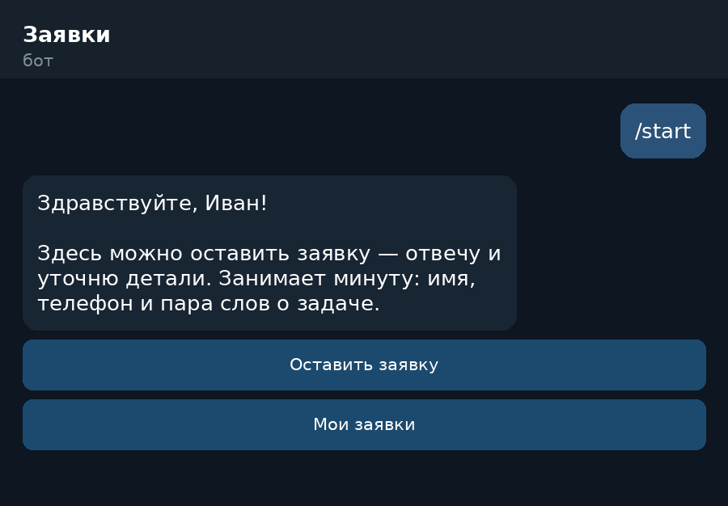
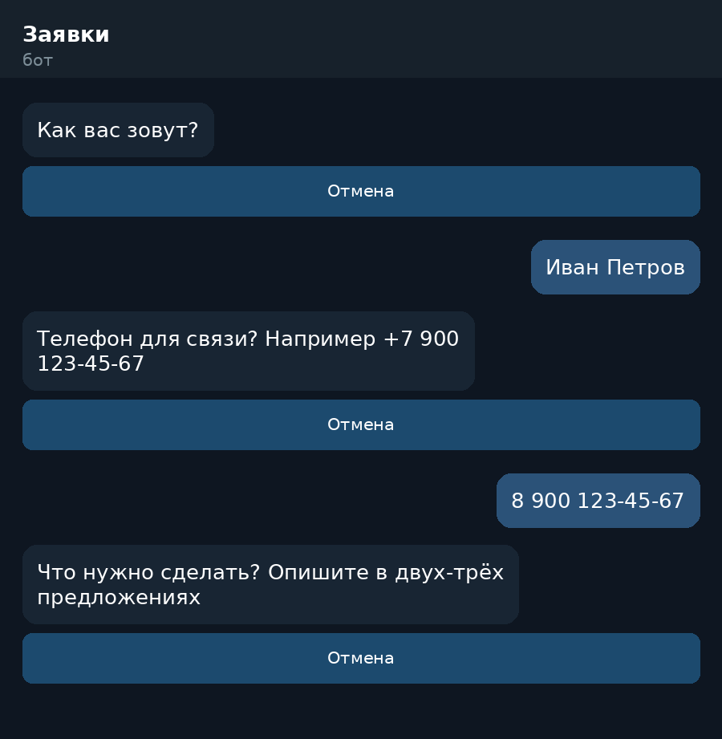
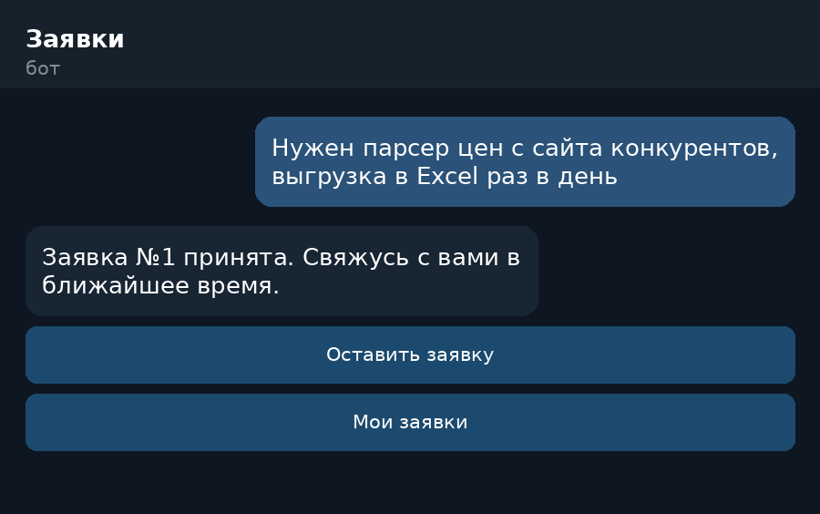

# Бот приёма заявок

Telegram-бот, который заменяет форму на сайте: человек нажимает кнопку, отвечает на три
вопроса, заявка сохраняется в SQLite и приходит администратору в личку.

Делал под небольшой сервисный бизнес, где заявки терялись в переписке.

<p>
  
  
  
</p>

Скриншоты не нарисованы руками: `scripts/make_screens.py` прогоняет настоящие хендлеры
с заглушками Telegram-объектов и отрисовывает то, что они вернули — тексты, клавиатуры
и порядок шагов берутся из кода.

## Стек

Python 3.11+ · aiogram 3 · aiosqlite · pydantic-settings · phonenumbers · pytest · ruff · Docker

## Что умеет

- меню на инлайн-кнопках, навигация без команд;
- пошаговая заявка на FSM: имя → телефон → описание задачи;
- валидация: имя без цифр и не короче двух символов, телефон приводится к E.164 через
  `phonenumbers` (понимает `8 900…`, `+7 (900)…`, `9001234567`);
- сохранение в SQLite через репозиторий, отдельного ORM не тащил — запросов три;
- уведомление админу; если он заблокировал бота, заявка всё равно остаётся в базе,
  ошибка уходит в лог;
- список своих заявок с пагинацией по 5;
- антифлуд middleware: гасит повторные нажатия и спам от одного пользователя.

## Структура

```
main.py                 точка входа: логирование, DI, polling
app/
  config.py             настройки из .env через pydantic-settings
  models.py             dataclass заявки
  validators.py         нормализация телефона, имени, текста
  db/
    base.py             соединение и схема
    repository.py       RequestRepository: add / by_user / count
  handlers/
    common.py           /start, /help, возврат в меню
    requests.py         FSM заявки, список, уведомление админу
  keyboards/inline.py   сборка клавиатур
  middlewares/throttle.py
tests/                  20 тестов: валидаторы, репозиторий, пагинация
```

Хендлеры не работают с базой напрямую — получают `RequestRepository` и `Settings` через
workflow data диспетчера. Поэтому репозиторий тестируется без бота, а хендлеры можно
переписать, не трогая SQL.

## Запуск

```bash
python -m venv .venv && source .venv/bin/activate
pip install -r requirements.txt
cp .env.example .env        # вписать BOT_TOKEN, при желании ADMIN_ID
python main.py
```

`ADMIN_ID` — id в Telegram, можно узнать у @userinfobot. Если не указан, бот работает
без уведомлений.

Docker:

```bash
cp .env.example .env
docker compose up -d --build
```

База лежит в `./data` и переживает перезапуск контейнера.

## Тесты и линтер

```bash
pip install -r requirements-dev.txt
pytest -q
ruff check .
```

## Решения, которые стоит объяснить

- **aiosqlite, а не SQLAlchemy.** Таблиц одна, запросов три. ORM добавил бы слой, который
  здесь нечего абстрагировать. При росте — переезд на SQLAlchemy + Alembic, репозиторий
  останется тем же интерфейсом.
- **FSM в памяти.** Состояние живёт в процессе: при рестарте недозаполненные заявки
  теряются. Для формы на минуту это приемлемо; для длинных сценариев нужен Redis.
- **Антифлуд в памяти, а не в Redis.** Работает в одном процессе. При переходе на
  несколько воркеров счётчик надо выносить наружу, иначе лимит будет на каждый процесс.
- **Телефон через phonenumbers.** Регулярка пропускает мусор вроде `+7 900 123-45-6`,
  библиотека проверяет ещё и длину с префиксом страны.

## Что дальше

- [ ] выгрузка заявок в Excel по кнопке для админа;
- [ ] админ-раздел: все заявки, смена статуса (новая / в работе / закрыта);
- [ ] напоминание админу, если заявка висит больше суток;
- [ ] экспорт в вебхук для CRM.
